  

 

## &nbsp;About Me

Hi, I'm **Azka**, an Informatics student exploring various areas of IT, currently focused on **full-stack web development**. I build end-to-end web applications, working across both frontend and backend, and enjoy continuously learning new technologies and tools along the way.

## &nbsp;Interests

- Full-stack web development
- Frontend & backend integration
- REST APIs & database management
- Exploring modern developer tools & frameworks

  

## &nbsp;Tech Stack

  

## &nbsp;GitHub Stats

  
  
    
  

  
  <i>Noli timere profundum</i>

